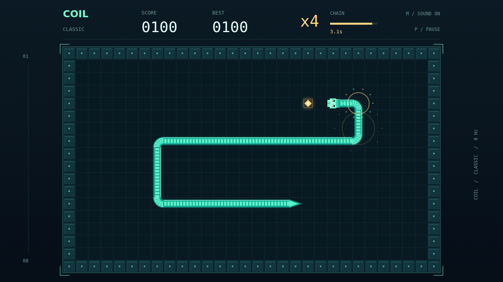

# Coil

A small grid. An endless appetite. Coil puts you in command of a luminous serpent in a dark, enclosed arena. The snake is always moving; every decision has to arrive before the next step.

Turn at right angles, collect the amber pellets, and watch your trail grow into a continuous coil. The walls are solid, and your own body is just as dangerous. Leave yourself an exit before you commit to a corner.

Hunger has a rhythm. Eat again within three and a half seconds and your multiplier climbs, all the way to x5. Each meal refills the window. Hesitate too long and the chain drops back to one, so the shortest route can be tempting even when it is tight.

Chase a new session best, pause to catch your breath, or start another round immediately. Play with arrows or WASD, or use the touch pad. A quiet synth pulse carries the run; crisp feeding tones and a heavy final drop tell you how it is going.

